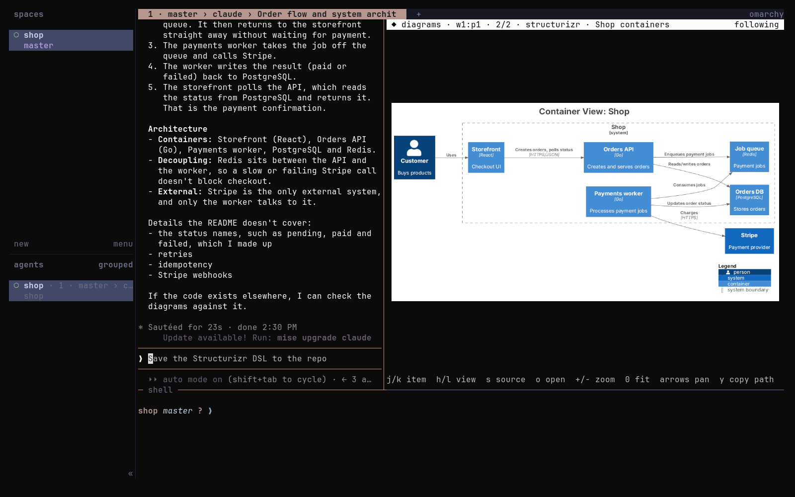

# Diagrams

A native GPUI diagram viewer panel for the Herdr desktop app that renders Mermaid, Structurizr (C4), PlantUML, D2, and Graphviz diagrams, and images, produced by coding agents via `herdr-diagram show`, synced to the active terminal and chat scroll position across local and remote (`hc`) machines.

## What you see

- **Top header bar** (`36px`, `chrome` background): diagram icon (`14px`, `accent`), active diagram title (`12.5px` semibold), `<format> · <index>/<total>` badge (`raised`), and action buttons (`‹` / `›`, `Sync ●` / `Sync ○`, `List (N)`, `Source`, `Export`).
- **Secondary control bar** (`28px`, `surface` background): bound terminal badge (`Pane: t3 (follow)` or `Pane: omarchy/t3`), multi-view C4 switcher (`◀ View 1/7 ▶` when viewing a Structurizr workspace), `Center` reset button when panned, and zoom controls (`−`, `100%`, `+`).
- **Optional left history drawer** (`210px`, `chrome` background, toggled by `List` or `i`): newest-first list of diagrams for the active pane with format and `HH:MM:SS` timestamp.
- **Interactive viewport canvas**: aspect-ratio-fitted high-DPI PNG diagram rendered natively on the GPU via `image("data/diagrams-cache/<sha256>.png")` inside an `.overflow_hidden().relative()` canvas with `cursor_grab` / `cursor_grabbing`, or a read-only syntax-highlighted source view (`Editor`) when `Source` (`s`) is toggled.

## How it behaves

- **Mouse pan & cursor-centered zoom**:
  - Drag with the **left** or **middle** mouse button to pan smoothly in any direction.
  - Scroll the **mouse wheel** to zoom in/out around the pointer (`e.local_position`).
  - Scroll horizontally or hold `Shift + wheel` to pan sideways.
  - **Double-click**, press `0` / `c`, or click **`Center`** / **`100%`** to reset pan and zoom.
- **Chat scroll sync & pinned selection**:
  - Polls `herdr-diagram app-state` and watches the local spool directory with `watchFolder()`.
  - When `Sync ●` is active, automatically advances when a brand-new diagram is queued or when the terminal's visible `[diagram: <title>]` marker changes.
  - Manual navigation (`j`/`k`, `<`/`>`, or clicking a row in `List`) pins the chosen diagram by ID (`selectedId`) and pauses scroll sync until `Sync` (`t` / `r`) is re-enabled.
- **Multi-machine (`hc`) support**:
  - Resolves `{ pane, on }` from `props().bind` or the active tab's terminal (`spaces()`, `panes()`, `focused()`).
  - When viewing a remote machine's space (such as `omarchy/t3`), runs `herdr-diagram app-state` on that machine (`{ on }`) and caches missing PNG artifacts locally under `~/.config/herdr-app/data/diagrams-cache/` via `herdr-diagram app-artifact`.
- **Keyboard shortcuts** (`"focusable": true`):
  - `j` / `k` or `Down` / `Up`: next / previous diagram (pauses scroll sync)
  - `h` / `l` or `Left` / `Right`: previous / next Structurizr C4 view
  - `Shift + H/J/K/L` or `Shift + Arrows`: pan viewport
  - `+` / `-` / `0` / `c`: zoom in / out / reset fit / center pan
  - `s`: toggle diagram source code
  - `i`: toggle diagram history drawer
  - `t` / `r` / `G`: resume scroll sync and jump to newest diagram
  - `g`: jump to first diagram
  - `e`: export current diagram (`herdr-diagram export`)

## Built from

- `mods/diagrams/main.js`, `mods/diagrams/mod.json`, `mods/diagrams/diagram.svg`, `keys.json`
- Calls `herdr` APIs: `spaces()`, `panes()`, `focused()`, `exec()`, `theme()`, `settings()`, `props()`, `appHome()`, `watchFolder()`, `nextCommand()`, `notify()`
- Calls `gpui-kit` / `gpui-base`: `View`, `div`, `svg`, `image`, `v_flex`, `h_flex`, `Editor`, `EditorState`
- Backend CLI (`jellespijker/herdr-diagrams`): `herdr-diagram show`, `herdr-diagram app-state`, `herdr-diagram app-artifact`, `herdr-diagram export`, `herdr-diagram install-mod`

## Watch out

- **Never write cached PNGs inside `mods/diagrams/`**: Herdr-App watches `mods/<name>/` and hot-reloads the mod whenever any non-hidden file is saved there, which resets the view state. Always store cached PNGs in `~/.config/herdr-app/data/diagrams-cache/<sha256>.png` and reference them via `image("data/diagrams-cache/<sha256>.png")`.
- **Clicking inside the mod pane moves focus to the mod pane** (`focused().terminal === null`): always fall back to the terminal in the active tab (`p.tab === activeTab && p.terminal`) or the last bound terminal (`lastTarget`), never `panes()[0]`.
- Never retain `cx` across async or event callbacks; always use the callback's own `cx`.

## Done when

- `herdr-app check ~/.config/herdr-app/mods/diagrams` passes with exit code `0`.
- Running `herdr-diagram show` inside a `herdr-core` (`hc`) terminal queues the diagram, syncs its PNG to `data/diagrams-cache/`, and opens or updates the `diagrams` GPUI mod pane beside the agent.
- Dragging with the mouse pans smoothly, scrolling zooms around the cursor, and switching to an earlier diagram stays pinned without flipping back.
